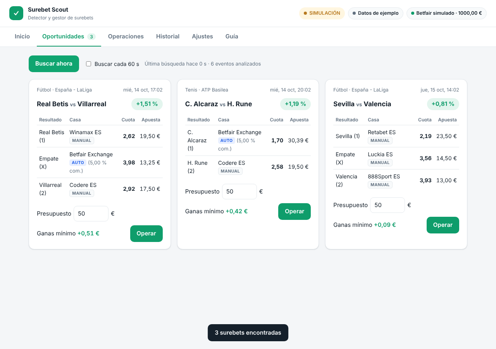
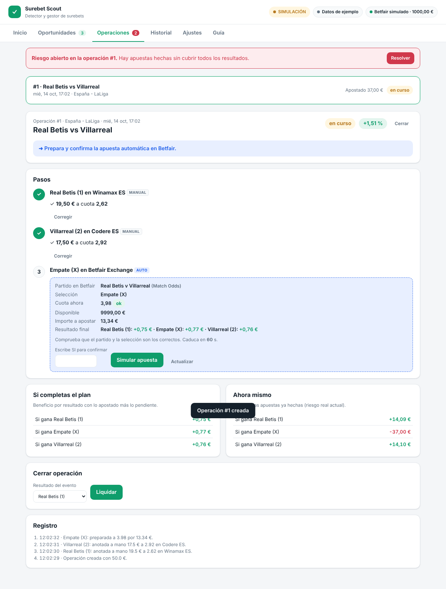

# Surebet Scout · versión web conectable

Web local para encontrar surebets entre tus casas españolas y gestionarlas paso a paso:
las apuestas en casas sin API las haces tú guiado por la web, y la de **Betfair Exchange**
la lanza el programa por su **API oficial** tras tu confirmación.

## Arrancar

```bash
cd surebet_scout/version_conectable
pip install -r requirements.txt
cp .env.example .env        # opcional: rellena tus claves
python app.py               # abre http://127.0.0.1:8050
```

Sin claves funciona entero en **simulación con datos de ejemplo**, así que puedes probar todo
el flujo sin riesgo.

## Qué hace

| Pestaña | Para qué |
|---|---|
| **Inicio** | Estado (simulación/real, datos, saldo Betfair), gasto del día, beneficio y lista de configuración. |
| **Oportunidades** | Busca surebets (a mano o cada 60 s) en **todos los deportes y todos los mercados y líneas** que da la API: ganador, más/menos, hándicaps, ambos marcan, córners, tarjetas, jugadores, periodos, sets, mapas… y doble oportunidad cruzada con el 1X2. Sin tope de porcentaje. Ordena por % de beneficio, € de beneficio o fecha, con filtros de % mínimo, tipo de mercado y deporte. |
| **Operaciones** | Guía paso a paso: primero las apuestas manuales (anotas la cuota real), después Betfair automático con la cuota en vivo. Muestra el beneficio por resultado y el riesgo abierto. |
| **Historial** | Todas las operaciones, liquidación y exportación a CSV. |
| **Ajustes** | Tus casas, comisiones, deportes, límites de dinero y redondeo de importes. |
| **Guía** | Cómo sacar las claves, activar el modo real y riesgos. |

## Qué cuenta como surebet

Solo se comparan grupos de resultados que cubren **todas** las posibilidades: 1X2, local/visitante,
más/menos de una línea, sí/no, par/impar, local/visitante/ninguno, y doble oportunidad
contra el 1X2 del mismo periodo (1X–2, 12–X, X2–1). Los mercados con un precio por etiqueta
(resultado exacto, goleador, etc.) se descartan: no garantizan cubrirlo todo y una "surebet"
ahí podría perder.

## Conexiones

- **Cuotas:** [odds-api.io](https://odds-api.io), una API oficial de datos que cubre casas .es
  (Bwin ES, Codere ES, Luckia ES, Retabet ES, Winamax ES, 888Sport ES, PokerStars ES,
  Betway ES, Betfair…). Es de pago y el precio depende del número de casas. Solo lee cuotas.
- **Apuestas automáticas:** Betfair Exchange (API-NG): inicio de sesión oficial por API,
  búsqueda del mercado *Match Odds*, cuota en vivo y orden **FILL_OR_KILL** (se casa entera
  o se cancela al instante).
- **Resto de casas:** no tienen API de apuestas para particulares; esas apuestas son manuales.
  No se automatiza su web ni se usan sus contraseñas.

## Surebets de BetOven u otros escáneres

BetOven Scanner es una aplicación de escritorio cerrada. No ofrece API, exportación ni
avisos que otro programa pueda leer, y sus condiciones prohíben la ingeniería inversa. Por eso
la integración es manual: en **Oportunidades → Añadir una surebet de BetOven u otro escáner**
copias el evento, las selecciones, las casas y las cuotas, ves al momento el margen y el
reparto, y al crearla se gestiona como cualquier otra operación. Admite cualquier mercado
(2 a 4 apuestas). Las patas 1/X/2 en Betfair con equipos y fecha pueden ir automáticas.
Las demás son manuales.

## Cuidar tus cuentas

Las casas limitan sobre todo por el tipo de apuesta (siempre cuotas por encima del mercado),
así que nada lo evita del todo. La web ayuda a durar más:

- Redondeo de importes (céntimos, 0,50, 1, 5 o 10 €). Elige la combinación que más gana en el
  peor resultado.
- Aviso cuando una apuesta manual supera tu máximo recomendado por casa.
- Aviso de margen sospechosamente alto (posible error de cuota: suelen anularse y marcar la cuenta).
- **Historial → Tus casas**: apuestas, volumen, pendiente y beneficio por casa, con aviso cuando
  llevas mucho ganado en una casa normal.

No se ayuda a usar cuentas ajenas, varias cuentas en la misma casa ni VPN: es fraude según
sus condiciones y pueden retener el saldo.

## Salvaguardas

- Simulación por defecto. Solo se apuesta de verdad con `SUREBET_LIVE=1` y las claves de Betfair.
- Confirmación escribiendo **SI** en cada apuesta de Betfair. La cuota preparada caduca a los 60 s.
- Si la cuota empeora o habría pérdida, hay que aceptarlo de forma explícita.
- Límites de importe por operación y por día. Mínimo de Betfair: 2 €.
- Betfair va siempre la última: su importe se calcula con las cuotas reales que anotaste.
- Avisos de **riesgo abierto** cuando una operación queda a medias.
- Si se corta la conexión al apostar, la apuesta queda en **estado desconocido** y no se
  reintenta hasta que confirmes en Betfair si se hizo.
- La web solo escucha en `127.0.0.1`, rechaza otros dominios y solo acepta escrituras en JSON.
- Las claves solo están en tu `.env` y en memoria; nunca se guardan en la base de datos.

## Pendiente de verificar con tu cuenta real

No se ha probado contra Betfair real (hacen falta tus claves). Antes de usar dinero, revisa
en developer.betfair.com las URL vigentes para España (configurables en `.env`) y haz una
primera operación con el mínimo. Comprueba también en Betfair que el partido y la selección
que muestra la web son los correctos.

## Archivos

`core.py` detector · `feeds.py` cuotas · `betfair.py` cliente API · `exchange.py` Betfair real/simulado ·
`service.py` lógica de operaciones · `store.py` SQLite · `web.py` API · `static/` interfaz · `tests/`

```bash
pip install -r requirements-dev.txt && pytest tests
```

## Capturas



